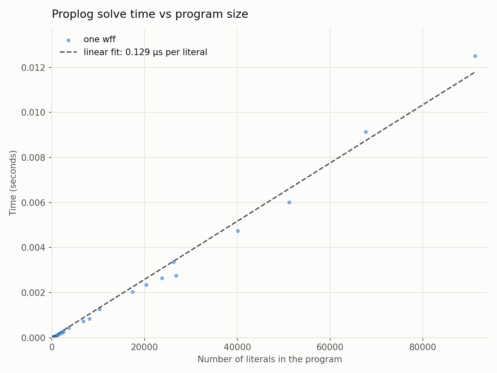
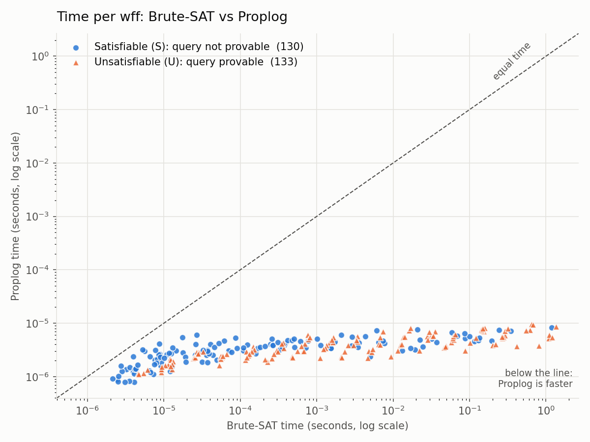
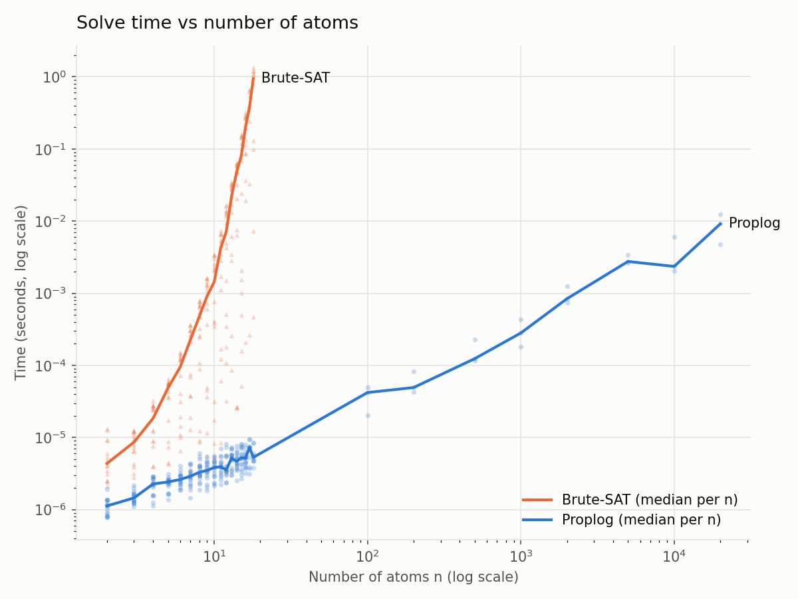

# Proplog Interpreter

A Proplog interpreter that solves the subset of SAT problems that can be expressed as sets of Horn clauses in less than exponential time.

## Project Structure and File Descriptions

```
.
├── charts/  # Result graph .png files
│   ├── proplog_time_vs_literals.png  # Proplog Solver Time v. Number of Literals
│   ├── scatter_brute_vs_proplog.png  # Proplog Solver Time v. Brute-SAT Solver Time
│   └── time_vs_n.png                 # Proplog and Brute-SAT Solvers v. Atom Count
├── data/  # Various Proplog problems
│   ├── generated.pl.cnf.csv
│   ├── generated.pl.csv
│   ├── large.pl.csv
│   ├── multiquery.pl.cnf.csv
│   └── multiquery.pl.csv
├── examples/  # Various Proplog problem examples (with logical meaning and variable names)
│   ├── girl.pl
│   ├── picnic.pl
│   ├── puzzles.pl.cnf.csv
│   ├── puzzles.pl.csv
│   └── vacation.pl
├── results/  # Proplog problem results
│   ├── brute_generated_results.csv
│   ├── brute_multiquery_results.csv
│   ├── brute_puzzles_results.csv
│   ├── proplog_generated_results.csv
│   ├── proplog_large_results.csv
│   ├── proplog_multiquery_results.csv
│   └── proplog_puzzles_results.csv
├── .gitignore
├── BruteSAT.py            # Brute-SAT solver from project 1A (for comparison with Proplog solver)
├── FORMAT.md              # Markdown document specifying the format in which Proplog should be represented by a .csv file (.pl.csv)
├── generate_wffs.py       # Generate random Proplog (Horn) wffs
├── make_examples.py       # Compile every examples/*.pl into one Proplog CSV file.
├── plot_results.py        # Plot graphs found in charts/
├── proplog_solver.py      # Proplog solver
├── proplog_to_CSV_CNF.py  # Proplog to CNF CSV form (.pl.cnf.csv) for Brute-SAT solver
├── proplog_to_CSV.py      # Proplog to CSV form (as specified by FORMAT.md)
├── README.md
├── run_all.py             # Helper file to run all steps
└── run_brute.py           # Run Brute-SAT steps
```

## Requirements
 
* Python 3.9 or newer (tested on 3.11 and 3.13).
* `matplotlib` for the charts: `pip install matplotlib`.
* Linux or macOS: Brute-SAT's timeout uses `SIGALRM`, which Windows does not have.
## Quick start
 
Rebuild every dataset, result and chart (about 2-3 minutes; nearly all of it is
Brute-SAT):
 
```
python3 run_all.py
```
 
Or run the steps individually:
 
```
python3 proplog_to_CSV.py examples/picnic.pl          # .pl -> examples/picnic.pl.csv
python3 run_brute.py examples/picnic.pl.csv           # label it with Brute-SAT
python3 proplog_solver.py --problem examples/picnic.pl.csv --verbose
```
 
## Results

See the graphed results in `charts/` demonstrating:
- `proplog_time_vs_literals.png`: Proplog solver time plotted against number of literals in the problem

- `scatter_brute_vs_proplog.png`: Log-log scatterplot of Proplog solver times plotted against Brute-SAT solver times, with satisfiability indicated by color

- `time_vs_n.png`: Log-log graph showing the Brute and Proplog solver times plotted against the number of atoms in the problem


On all **263** problems that Brute-SAT could solve, the two solvers give the
same answer. On the 24 large problems, every `S` assignment the Proplog solver
returned was checked against every clause.
 
**Speedup** is how many times faster Proplog is than Brute-SAT on the same
problem (Brute-SAT's time divided by Proplog's time). These were run on Ricky-Bobby.
Taking the median over the problems:
 
| Problems | Median speedup |
|---|---|
| All 263 problems both solvers solved | **103x** |
| Problems with 15 or more atoms | **24,404x** |
 
The speedup grows with size because Brute-SAT's work doubles with every extra
atom while Proplog's barely changes. The slowest problem for Brute-SAT (18 atoms) 
took it 1.35 seconds; Proplog solved it in microseconds.

Brute-SAT searches through every possible assignment to see if one of them satisfies the problem, and in the worst case scenario may not find the correct assignment until the last check. If the SAT problem is unsatisfiable a similar situation arises. Potentially needing to try every possible assignment gives Brute-SAT a time complexity of O(2^n) which is of course computationally intensive.

With Proplog however, we can take advantage of the fact that each clause has at most one positive literal which allows for simple logical resolution. The Proplog algorithm, in contrast with the inherently large statespace checked by the Brute Force Solver as previously described, is able to utilize rule resolution based on established facts and forward propagate those established facts to iteratively resolve to all the conclusions that can be derived from the clauses (which are in the Horn clause form, which allows for this resolution procedure to be essentially checks of a set of previously derived facts). This iterative method yields all the facts that can be derived which is then checked against the final query clauses. This procedure inherently generates a correct assignment if it exists which is far more efficient.